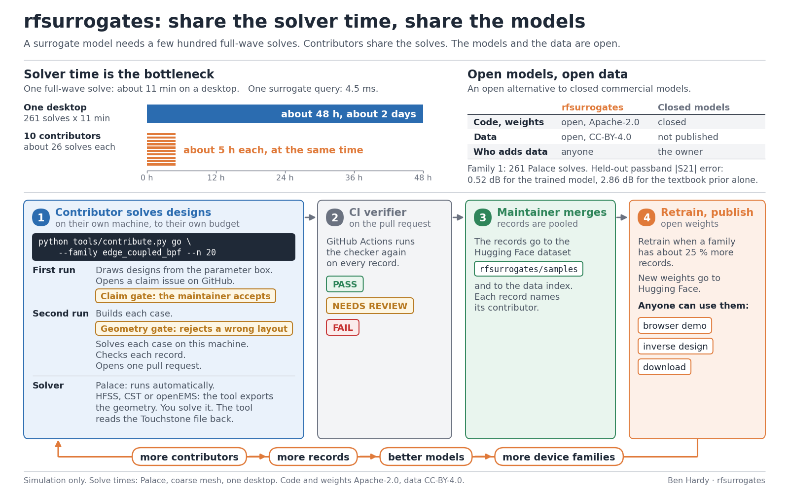

# Contributing



There are three ways to help: solve designs, add a device family, or improve the code.

> **Status (v0.1, 2026-10-26):** data contributions open with v0.2, when the verifier runs on the main branch. You
> can run the steps below now to practise with `--local`. Code issues and pull requests are welcome now.

## Solve designs

You run a solver on your own machine. One command does the rest.

### What it costs

Measured for `edge_coupled_bpf` on one 8-thread desktop (Palace 0.16 in Apptainer under WSL2, 25 GB):

| fidelity | setup | per solve | peak RAM per job |
|---|---|---|---|
| coarse (production) | mesh scale 1.8, order 2, 4 ranks, two jobs at a time | 11 min mean (7-24 min) | 2.0 GB mean, 2.5 GB max |
| medium (holdout) | mesh scale 1.4, order 2, 8 ranks | about 15-20 min | about 3.9 GB |

A batch of 50 coarse solves takes about 5 hours with two jobs at a time.

### Steps

1. **Set up.** Fork the repo, clone your fork, and install:
   ```
   python -m venv .venv && . .venv/bin/activate          # Windows: .venv\Scripts\activate
   pip install torch --index-url https://download.pytorch.org/whl/cpu
   pip install -r requirements.txt
   ```
   For Palace, put `palace` on PATH or set `PALACE_SIF` to a Palace Apptainer image. Any other launch command works
   with `--runner "<command>"`; it is called as `<command> config.json <ranks>`. On Windows, add `--wsl <distribution>`.

2. **Draw and claim designs.**
   ```
   python tools/contribute.py go --n 20 --contributor <your GitHub handle> --open-claim
   ```
   The tool draws 20 valid designs from the family box, prints the cost estimate and opens a claim issue. Without
   `--open-claim` it writes the claim text to `work/<batch>/claim.md` for you to post. The maintainer checks the
   claim and adds the label `status:accepted`.

3. **Solve and check.** After the claim is accepted:
   ```
   python tools/contribute.py go --batch <batch> --budget-hours 4 --jobs 2
   ```
   The tool builds each case, solves it, collects the result and checks it. You set the budget: it starts no solve
   that would go past it. Stop it at any time with a file named `STOP` in `work/<batch>/`. Run the same command again
   to continue.

4. **Open the pull request.** When every design is finished, `go` stages the files in `incoming/<family>/<batch>/`.
   ```
   python tools/contribute.py submit --batch <batch> --open-pr
   ```
   This commits with a sign-off, pushes the branch `data/<batch>` to your fork and opens one pull request. Without
   `--open-pr` it prints the git commands.

With an AI coding agent, ask it to use the `contribute-data` skill. It runs these steps and asks you at each gate.

### Other solvers (HFSS, CST, openEMS, ...)

```
python tools/contribute.py go --n 20 --contributor <handle> --solver hfss --solver-version <version>
```

After the claim is accepted, `go` writes the geometry of each design to `work/<batch>/geometry/` as JSON and DXF,
with instructions in `work/<batch>/EXTERNAL_SOLVER.md`. Solve each design and save a two-port Touchstone file as
`work/<batch>/touchstone/<id>.s2p`. Then run `go --batch <batch> --mesh-elements N --mesh-unknowns N` again.

Records from another solver form the fidelity group `other`. The project publishes no accuracy comparison per solver
or between solvers. You are responsible for what your solver licence allows you to share.

### Verdicts

Every record gets one verdict from `contrib/check_sample.py`. `contrib/README.md` lists every check.

| verdict | meaning | what you do |
|---|---|---|
| PASS | the record meets the contract | nothing |
| NEEDS REVIEW | physically fine, but a reviewer must look (for example far from the prior) | add one sentence on why, in `review_notes` in `work/<batch>/batch.json` |
| FAIL | schema, box, validity rule, passivity, reciprocity or provenance fails | nothing: it is not submitted |

### What happens to your pull request

1. **CI** (`tools/verify_batch.py`) reruns the checker on every record with the rules of the main branch. It also
   checks the file hashes, duplicates against the data index, and that the pull request changes only `incoming/`.
2. **A reviewer** reads the NEEDS REVIEW sentences. For a new solver or a new contributor, the maintainer solves one
   design again with Palace and notes the difference on the pull request. A large difference does not reject the
   batch; the batch becomes its own fidelity group.
3. **After the merge**, the maintainer uploads the records to the Hugging Face dataset `rfsurrogates/samples` and adds
   the rows to the data index (`tools/ingest_batch.py`).
4. **Retraining** happens per release, when a family has about 25 % more records or a new fidelity group.

### Credit

Every record names its contributor. Each model card lists the contributors with their record counts and fidelity
groups. Releases name the data index version they were trained on.

## Add a device family

Open an issue with the family form. Give the device, the parameter vector and its box, an analytic prior (a textbook
reference is enough), the validity rule, the frequency grid, the ports and the metrics. The hairpin band-pass filter
is next. A family folder holds the definition only; see `families/edge_coupled_bpf/` and the hooks in its `family.py`.

## Improve the code

Open an issue first for anything beyond a small fix. Put tests next to the code and run `python -m pytest tests -q`.
Do not change training code in a data pull request. Sign off your commits (`git commit -s`, Developer Certificate of
Origin).
