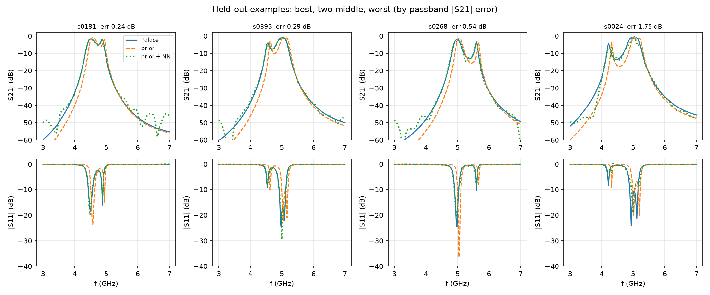

# rfsurrogates

Open surrogate models of passive microwave devices. A model takes a device's geometry and returns its S-parameters
in milliseconds, where a full-wave solve takes minutes. Each model needs a few hundred solves to train, so this
project splits that compute: contributors run a solver on their own machines and submit checked results.



*Four filters the model never saw: the Palace solve (blue), the textbook prior (orange) and the trained model
(green). Best, two middle and worst by passband error.*

## Status

v0.1, 2026-10-26. One device family, data from one contributor.

| family | training data | held-out passband \|S21\| error |
|---|---|---|
| [Edge-coupled microstrip band-pass filter](families/edge_coupled_bpf/README.md), RO4350B, 3-7 GHz | 261 Palace solves | 0.52 dB (textbook prior alone: 2.86 dB) |

The model is checked against simulation only. Nothing here was measured. The limits are in the
[model card](families/edge_coupled_bpf/MODEL_CARD.md).

## Try it

**In the browser.** The [demo page](https://benjhardy.github.io/filter-surrogate/) runs the model with no install.
Set a geometry, see S11 and S21, and ask for a geometry that meets a spec.

**On your machine.** Python 3.12 and a CPU are enough.

```
git clone https://github.com/benjhardy/rfsurrogates && cd rfsurrogates
python -m venv .venv && . .venv/bin/activate          # Windows: .venv\Scripts\activate
pip install torch --index-url https://download.pytorch.org/whl/cpu
pip install -r requirements.txt
python tools/fetch.py                                 # download weights and records from Hugging Face
python core/inverse.py --f0 5.2 --bw 0.5 --rl 10      # find a geometry for a spec, about 30 s
```

`core/inverse.py` prints the geometry, the predicted response and the command to check it with Palace.

## Contribute

There are three ways to help. [CONTRIBUTING.md](CONTRIBUTING.md) has the step-by-step guide for each.

1. **Solve designs.** Run a batch of filter designs with your own solver, check each result with one script, and
   submit the records. A batch of 50 takes about 5 hours on a desktop with Palace. Data pull requests open with
   v0.2, when the checker runs in CI. Until then, open an issue if you want to prepare data.
2. **Add a device family.** Propose a device with a parameter box and a textbook model of its response. The hairpin
   band-pass filter is next. The [coverage map](docs/COVERAGE.md) lists 31 device types and their status.
3. **Improve the code.** Issues and pull requests are welcome now. Open an issue first for anything beyond a small
   fix, and run `python -m pytest tests -q` before you submit.

Every record names its contributor, and each model card lists who computed what.

## How it works

Each device family has a generator that turns a geometry vector into solver input, a textbook model of the response
(the prior), and a parameter box. The network learns only the difference between the prior and the solver. Because
of the prior, a new family gives a useful model from its first few dozen solves. Every family also keeps designs
solved on a finer mesh, so the model error is published next to the mesh error.

More: [project design](docs/OPEN_PROJECT.md) (including the repo layout and roadmap),
[data contract](docs/DATA_CONTRACT.md), [fidelity policy](docs/FIDELITY.md).

## Where things are

- **Code:** this repo.
- **Weights:** one Hugging Face model repo per family, for example
  [rfsurrogates/edge-coupled-bpf](https://huggingface.co/rfsurrogates/edge-coupled-bpf).
- **Records:** the Hugging Face dataset [rfsurrogates/samples](https://huggingface.co/datasets/rfsurrogates/samples).
  The manifests in `data_index/` hold the hash of every file, and `tools/fetch.py` checks them.

## Licence

Code and weights are Apache-2.0. Records and the data index are CC-BY-4.0. Cite with [CITATION.cff](CITATION.cff).
