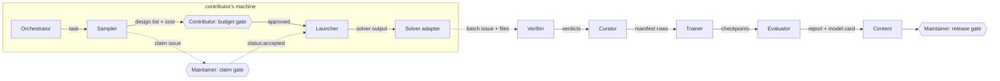

# Agent roles and guard rails (draft, 2026-10-26)

Status: partly built (2026-10-27). Three pieces exist; the other roles are still a design.

| piece | where | role it covers |
|---|---|---|
| one-command contributor path with the launcher rules (machine lock, STOP file, budget, timeout, case root) | `tools/contribute.py` | sampler, launcher, solver adapter (Palace; export and import for other solvers) |
| verifier in CI: the checker rerun on every record of a data pull request, with the rules of the base branch | `tools/verify_batch.py`, `.github/workflows/verify-data.yml` | verifier |
| contributor skill and repo rules for agents | `.claude/skills/contribute-data/SKILL.md`, `AGENTS.md` | the gates for an agent on a contributor's machine |
| maintainer ingest: upload to Hugging Face, rows to the data index | `tools/ingest_batch.py` | curator |

The open questions at the end need the maintainer's decisions.

## Decisions

| date | question | decision | what follows |
|---|---|---|---|
| 2026-10-26 | Where do agents run? | On the contributor's own machine, for now. | The contributor is the person at the budget gate for their own compute. The maintainer's gates are the design claim, the merge of records and the release. The project runs no agents for contributors. |
| 2026-10-26 | What holds the task queue? | GitHub issues. | Issue forms in `.github/ISSUE_TEMPLATE/` (claim, batch, family, task) and the labels in `.github/labels.json` (`role:*`, `kind:*`, `status:*`). Run requests, claims and verdict summaries are issues; records and results stay files. |
| 2026-10-27 | How does a contributor run the path? | One command, `tools/contribute.py go`, run twice: before and after the claim is accepted. | The claim gate stays. The launcher rules are in the tool, not a separate role. Data pull requests carry the records in `incoming/`; the maintainer uploads them to Hugging Face after the merge. |
| 2026-10-27 | Which solvers? | Palace runs inside the tool; HFSS, CST, openEMS and others by geometry export (JSON, DXF) and Touchstone import. | Other solvers form the fidelity group `other`. |

## Principles

1. **Separation of duties.**
   - The role that makes data does not verify it.
   - The role that trains does not choose or edit the data, the splits or the holdout.
   - The role that evaluates a model did not train it.
2. **One solver launcher per machine.** Only the launcher starts a solver. Every other role asks the launcher with a
   run request.
3. **Files, not chat, carry the work.** Each hand-over is a file with a schema: a run request, a solver record, a
   verdict, a manifest row, a results file. A role reads the files it needs and writes only its own outputs.
4. **Humans hold the gates.**
   - The contributor approves solver budgets on their own machine above a limit they set.
   - The maintainer (Ben) approves design claims, merges, Hugging Face uploads, pushes, releases and
     announcements.

   Public text is written by people.
5. **Agents are optional.** A person can do any role. An agent in a role passes the same checks as a person.
6. **Numbers come from files.** No role writes a number in a document unless a result file it can cite contains that
   number.

## Roles

| role | does | reads | writes | may not |
|---|---|---|---|---|
| **Orchestrator** | turns the roadmap and `coverage.json` into tasks; assigns roles; tracks state; asks the maintainer at the gates | roadmap, `coverage.json`, task queue, verdicts | tasks, status reports | run a solver; edit data, weights or family code; approve its own budget |
| **Family author** | adds a device family: generator, geometry gate, prior, box, validity rule, metrics, tests | `families.json`, an existing family as template | `families/<id>/`, a registry entry, tests | run more than a pilot (about 2 solves) without an approved run request |
| **Sampler** | chooses designs to solve (space-filling, then active learning) and the cost estimate (`palace_estimate_cost`) | family box, validity rule, current model, cost records | run requests with design list, fidelity and estimated solver-hours | start runs; change the holdout list |
| **Launcher** (one per machine) | the only role that calls `palace_run` or another solver; holds the machine lock; obeys the STOP file and the budget | approved run requests | case folders, `run_record.json`, logs | accept a request without approval above the budget; expose `cmd` or `force` to others; write outside the allowed case root |
| **Solver adapter** (one per solver: Palace, openEMS, ...) | converts the family's geometry into that solver's input, and its output into a contract record | family generator output | solver input files; records in `rfsurrogates.sample/1` | compare solvers by name in public results (commercial-tool rule) |
| **Verifier** | checks every record before it counts | records, solver logs, `palace_results` output | verdict (PASS / NEEDS REVIEW / FAIL) and check list per record; mesh-study report per family | edit or delete records; verify records it produced |
| **Curator** | keeps the data index: manifest rows, hashes, provenance, contributor and licence fields, de-duplication; stages Hugging Face uploads | records with verdicts | `data_index/<family>/manifest.jsonl`, `dist/hf/` | upload or push without the maintainer's OK; default a contributor or licence |
| **Trainer** | trains a release on PASS records only, with fixed seeds and the fixed split | manifest (PASS rows), family code, `core/` | checkpoints, `results/`, training log | change splits or the holdout; train on NEEDS REVIEW or FAIL records; edit records |
| **Evaluator** | checks a release independently: rebuilds the metrics from the weights; compares with the previous release; runs the inverse-design check (through the launcher) | checkpoints, holdout, previous release | evaluation report; regression verdict; generated model card | train or tune the model it evaluates |
| **Content** | keeps `coverage.json`, `docs/COVERAGE.md`, READMEs, model cards and web pages up to date and consistent; plain technical register | result files, verdicts, `coverage.json` | docs and pages (generated where a generator exists) | write numbers that are not in a result file; write announcements |
| **Maintainer** (human) | approves budgets, merges, releases, uploads and public text | everything | approvals | none |

### Flow for one batch of new data

Everything in the box runs on the contributor's machine. Each dotted arrow is a GitHub issue (claim, batch) or a
pull request.

The verifier, curator, trainer and evaluator steps are done by the maintainer (with or without agents) until other
people take those roles.

## What the verifier checks

Already present:
- **`contrib/check_sample.py`:** schema, hashes, grid, the family validity rule, passivity, reciprocity, prior
  plausibility.
- **`palace_check` in palace-agent-tools:**
  - passivity as the eigenvalue bound of S^H S;
  - reciprocity, energy balance (flat loss from absorbing walls placed too close), port symmetry;
  - spurious port modes, AMR convergence;
  - a log scan for about 25 known failure messages.

To add (gaps found in palace-agent-tools on 2026-10-26):
- **Adaptive frequency sweep converged.** `parse_log` reads the result, but `palace_check` does not evaluate it.
  This is the most important missing check.
- **Linear solver.** Krylov iteration counts and residual limits; today a failure is only seen through log messages.
- **Spot frequencies.** Compare 2-3 directly solved frequencies with the adaptive sweep at those points.
- **Mesh study per family.** A fixed fraction of designs (for example 5 %) is solved again at a finer mesh. Report the
  coarse-vs-fine error next to the model error, as `docs/FIDELITY.md` does now.
- **Power balance per port.** The low-pass experiment found a flat 2 % loss at a wide-strip wave port. That case
  must give NEEDS REVIEW, not PASS.

## Guard rails for the launcher

palace-agent-tools has `guard()`: it refuses a run when the CPUs are busy, the ranks exceed the CPU count or memory
would go above 90 %, unless `force` is set. It also has `dry_run`. The launcher adds:

- **Machine lock.** A lock file for the whole run. Today the busy check uses `pgrep`, so two runs that start at the
  same moment can both pass it.
- **STOP file.** The launcher checks it before each case and between cases.
- **Budget limit.** A maximum number of solver-hours per request without approval, and a hard timeout per case
  (`timeout_s` today has no default).
- **Allowed case root.** Case folders only under that root.
- **No shell templates or force for other roles.** `cmd`, `PALACE_TOOLS_CMD` and `force` are never taken from a run
  request.
- **Run record.** Each run records the request id, the approver and the actual cost.

Some of these belong upstream in palace-agent-tools (lock, STOP file, default timeout, adaptive-convergence check).
The rest belong in an rfsurrogates launcher wrapper.

## How the roles would be implemented

- **`AGENTS.md`** at the repo root: the rules every agent reads, whatever its tool.
- **`.claude/agents/<role>.md`:** one Claude Code subagent per role. Its `tools` list is the guard rail: for example,
  only the launcher gets the `palace_run` MCP tool, and the trainer gets no solver tools at all.
- **MCP servers:**
  - `palace-tools`, from palace-agent-tools, for building, linting, estimating, running and checking;
  - later a small `rfsurrogates` server with `check_record`, `make_records`, `coverage` and `fetch`, so that agents
    call the checks instead of re-implementing them.
- **GitHub issues** carry the tasks (decided 2026-10-26): the forms in `.github/ISSUE_TEMPLATE/` and the labels in
  `.github/labels.json`. `tests/test_issue_templates.py` checks that the forms use only listed labels. An agent
  reads and writes issues with `gh`; only the maintainer sets `status:accepted`.
- **CI** runs the verifier and the content checks (`tools/make_coverage.py --check`, numbers-from-files lint) on every
  pull request. A contributor's own agents then face the same gates as the project's.

## Open questions

Questions 1 (where agents run) and 2 (task queue) are decided; see [Decisions](#decisions).

3. **Orchestrator scope.** With agents on contributors' machines, each contributor has their own orchestrator. Does
   the project also keep one that only opens and labels issues from the roadmap and `coverage.json`?
4. **Budget.** The contributor sets the limit for their own machine. Does the project set a maximum claim size
   (for example 50 designs or 10 solver-hours per claim), so that ids are not held for a long time?
5. **Second solver.** Which first: openEMS (open FDTD), Elmer, or none until v0.3?
6. **Mesh-study fraction.** What share of each batch is solved again at a finer mesh (for example 5 %), and is a
   family blocked from release without it?
7. **Upstream fixes.** Put the missing checks and the lock into palace-agent-tools (it helps every user of it), or
   keep them in rfsurrogates?
