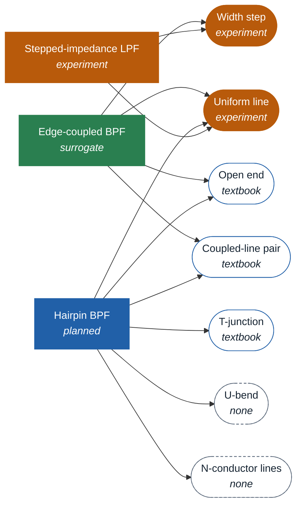

# Coverage

<!-- generated by tools/make_coverage.py from coverage.json; do not edit -->

Which passive devices have a surrogate, which are planned, and which building blocks they share. Interactive map: `web/coverage.html`. To propose a device, see [CONTRIBUTING.md](../CONTRIBUTING.md).

31 device types: 1 surrogate, 1 planned, 1 experiment, 28 open.

| status | meaning |
|---|---|
| surrogate | registered family with published data and weights |
| planned | on the roadmap; no data yet |
| experiment | exploratory work outside the registry; no published model |
| open | no work yet; proposals welcome |

## Work started

## Devices

| group | device | status | routes | blocks | outputs |
|---|---|---|---|---|---|
| Filters | [Edge-coupled BPF](../families/edge_coupled_bpf/README.md) | surrogate | family, compose | Uniform line, Coupled-line pair, Open end, Width step | S11, S21 |
| Filters | Hairpin BPF | planned | family, compose | Coupled-line pair, N-conductor lines, U-bend, T-junction, Open end, Uniform line | S11, S21 |
| Filters | Stepped-impedance LPF | experiment | compose | Uniform line, Width step | S11, S21 |
| Filters | Open-stub LPF | open | compose | Uniform line, T-junction, Open end, Width step | S11, S21 |
| Filters | Stub band-stop | open | compose | Uniform line, T-junction, Open end | S11, S21 |
| Filters | Interdigital BPF | open | family, compose | N-conductor lines, Via, Open end, T-junction | S11, S21 |
| Filters | Combline BPF | open | family, compose | N-conductor lines, Via, Component pad | S11, S21 |
| Filters | Open-loop resonator BPF | open | family | Uniform line, Mitred bend, Coupled-line pair, Open end | S11, S21 |
| Filters | SIW cavity filter | open | family | SIW section, Via, Uniform line | S11, S21 |
| Filters | Pixelated filter | open | grid | - | S11, S21 |
| Couplers and dividers | Branch-line coupler | open | compose | Uniform line, T-junction, Width step | 4-port S |
| Couplers and dividers | Rat-race coupler | open | compose | Uniform line, T-junction | 4-port S |
| Couplers and dividers | Coupled-line coupler | open | family, compose | Coupled-line pair, Uniform line, Mitred bend | 4-port S |
| Couplers and dividers | Lange coupler | open | family | N-conductor lines, Air bridge / wire | 4-port S |
| Couplers and dividers | Wilkinson divider | open | family, compose | Uniform line, T-junction, Mitred bend, Component pad | 3-port S |
| Couplers and dividers | Marchand balun | open | family, compose | Coupled-line pair, Via, Open end | 3-port S |
| Matching and transitions | Quarter-wave transformer | open | compose | Uniform line, Width step | S11, S21 |
| Matching and transitions | Stub match | open | compose | Uniform line, T-junction, Cross junction, Open end, Radial stub | S11, S21 |
| Matching and transitions | Tapered line | open | compose | Uniform line, Width step | S11, S21 |
| Matching and transitions | Microstrip-CPW transition | open | family | Uniform line, CPW line, Via | S11, S21 |
| Matching and transitions | Layer-to-layer via | open | family | Via, Component pad, Uniform line | S11, S21 |
| Matching and transitions | Connector launch | open | family | Coax launch, Uniform line | S11, S21 |
| On-chip and lumped | Spiral inductor | open | family | Spiral winding, Air bridge / wire | 2-port S (L, Q) |
| On-chip and lumped | Planar transformer | open | family | Spiral winding, Air bridge / wire | 4-port S |
| On-chip and lumped | Interdigital capacitor | open | family | Interdigital cap. | 2-port S (C, Q) |
| Antennas | Inset-fed patch | open | family | Patch radiator, Uniform line, Width step | S11, gain, pattern |
| Antennas | Patch array 2x2 | open | compose | Patch radiator, Uniform line, T-junction, Mitred bend | S11, gain, pattern |
| Antennas | Printed dipole | open | family | Uniform line, Open end | S11, gain, pattern |
| Antennas | Vivaldi | open | family, grid | - | S11, gain, pattern |
| Resonators and coils | Ring resonator | open | compose | Uniform line, Series gap | S11, S21 |
| Resonators and coils | MRI birdcage coil | open | family | Component pad | S11, B1 field |

## Building blocks

A block model fitted once serves every device that uses it (route `compose`). Sorted by use.

| block | kind | status | used by |
|---|---|---|---|
| Uniform line | Lines and stubs | experiment | 21 |
| Open end | Lines and stubs | textbook | 9 |
| T-junction | Discontinuities | textbook | 9 |
| Width step | Discontinuities | experiment | 7 |
| Via | Other elements | textbook | 6 |
| Coupled-line pair | Coupled structures | textbook | 5 |
| Mitred bend | Discontinuities | textbook | 4 |
| N-conductor lines | Coupled structures | none | 4 |
| Component pad | Other elements | none | 4 |
| Air bridge / wire | Other elements | none | 3 |
| Spiral winding | Other elements | textbook | 2 |
| Patch radiator | Other elements | textbook | 2 |
| Radial stub | Lines and stubs | textbook | 1 |
| CPW line | Lines and stubs | textbook | 1 |
| U-bend | Discontinuities | none | 1 |
| Cross junction | Discontinuities | textbook | 1 |
| Series gap | Discontinuities | textbook | 1 |
| Interdigital cap. | Coupled structures | textbook | 1 |
| SIW section | Other elements | textbook | 1 |
| Coax launch | Other elements | none | 1 |

| block status | meaning |
|---|---|
| learned | block model fitted to solver data and checked on held-out solves |
| experiment | block solved or fitted in an experiment; not published |
| textbook | closed-form model only (accuracy limits apply) |
| none | no usable closed form; needs solver data |

## Routes

| route | meaning |
|---|---|
| family | fixed topology, parameter vector in, S-parameters out (prior + learned correction) |
| compose | building blocks joined by network theory, plus a small learned correction for the device |
| grid | pixel or polygon layout in, inside one footprint and stackup (needs 10^4-10^5 solves in published work) |
